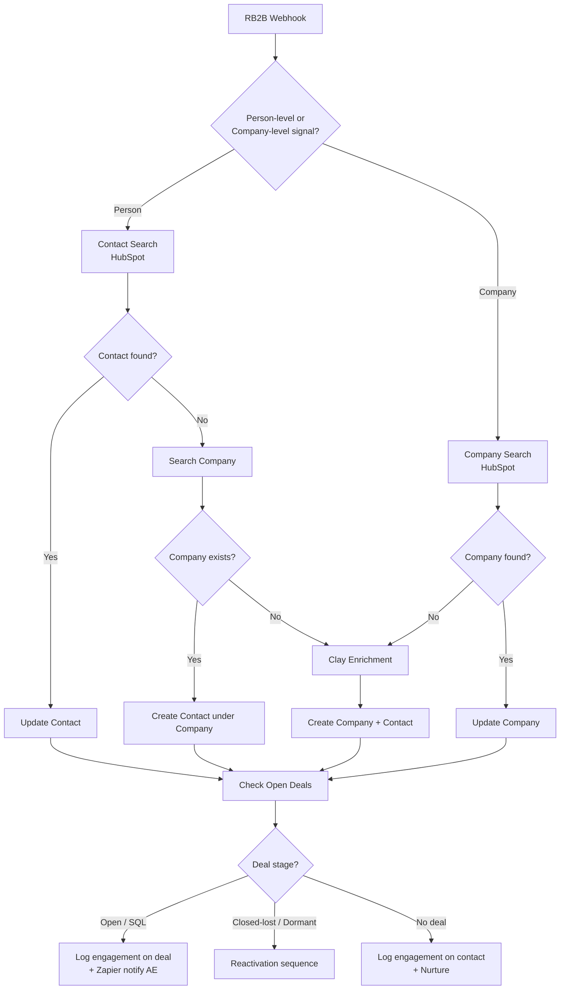

# RB2B → HubSpot De-anonymization Pipeline

> A production n8n workflow that catches anonymous website visitors identified by RB2B, dedupes them against HubSpot, enriches via Clay, and routes them to the right CRM flow based on whether they're a known prospect, an open deal, or a fresh ICP fit.

**Author:** Vatsal · **Built for:** Peoplebox.ai (B2B SaaS) · **Stack:** n8n · HubSpot · Clay · RB2B · Zapier

---

## The problem

[RB2B](https://www.rb2b.com/) reverse-resolves anonymous LinkedIn profiles for US-based website visitors. The raw RB2B feed is useful, but only if it lands in HubSpot correctly. Most teams pipe RB2B into a Slack channel and call it done — which means every visitor gets treated as cold, even when they're an existing lead, an open opportunity, or a closed-lost account worth reactivating.

The actual GTM question is: **"Given a person who just visited the site, what's the right next move?"** That depends entirely on what HubSpot already knows about them.

| Visitor status in HubSpot | Right next move |
|---|---|
| Brand new person, brand new company | Enrich → create contact + company → notify SDR |
| Known contact, no open deal | Log engagement → trigger nurture |
| Known company, new contact | Create contact under existing company → notify deal owner |
| Open deal exists | Log engagement on the deal → ping the AE in Slack |
| Closed-lost / dormant | Reactivation sequence, not generic outreach |
| Customer | Notify CSM, not sales |

Doing this manually is impossible at volume. Doing it half-right (e.g., always creating a new contact) corrupts the CRM. This pipeline does it right.

## The solution



A 48-node n8n workflow that:

- Receives RB2B payloads via webhook (person-level or company-level signal)
- Routes through HubSpot to determine the visitor's status
- Enriches missing data via Clay when the record is new
- Creates engagements on the correct CRM object (deal if open, contact otherwise)
- Triggers downstream Zapier hooks for real-time AE notifications on hot signals

---

## System design decisions

### 1. Routing-first architecture

The first decision the workflow makes is the most important: is this a **person-level** signal (RB2B resolved a specific LinkedIn profile) or a **company-level** signal (RB2B resolved the company but not the individual)? These are fundamentally different inputs and they get fundamentally different treatment.

- **Person-level** → search for the contact first, then walk up to the company
- **Company-level** → search for the company directly, never create speculative contacts

Mixing these paths is the most common failure mode in RB2B integrations — it produces duplicate contacts ("Unknown Person at Acme Corp") that pollute the CRM forever.

### 2. The dedup ladder

The Achilles' heel of any enrichment pipeline is duplicate creation. Every "search → if not found, create" pattern is one bug away from CRM contamination. This workflow uses a four-rung ladder:

1. Search by email (highest signal)
2. Search by full name + company domain
3. Search by LinkedIn URL
4. Only then: create

Each rung has its own `if` node and explicit no-result handling. The cost is node count (48 nodes vs ~25 for a naive version). The benefit is that 3 months in, the contact table is still clean.

### 3. Stage-aware engagement creation

A visitor pinging the pricing page means very different things depending on deal stage. The workflow runs a `Meeting Status` switch with 3 branches:

- **No deal in pipeline** → create engagement on contact, route to nurture
- **Open deal in early stage** → create engagement on the deal record so the AE sees it in their queue
- **Open deal in late stage (negotiation / closed-won imminent)** → create engagement + fire Zapier webhook for real-time Slack ping

This puts the right signal in front of the right person. AEs don't get pinged on tire-kickers; CSMs don't get pinged on net-new prospects.

### 4. Idempotent webhook handling

The webhook is the only entry point and RB2B can (and does) re-send the same payload. Every write operation is structured as `search → upsert` rather than `create`. Running the same payload through the workflow twice is a no-op on the second pass — the second engagement isn't created because the dedup catches it.

This matters because retry semantics from third-party webhooks are not under your control. If RB2B retries on a timeout, you don't want every visitor logged twice.

### 5. Clay as fallback enrichment, not first-line

Clay calls are expensive (per-credit pricing) and slow (~10s latency). The workflow only hits Clay when:
- The company is brand new to HubSpot, AND
- The RB2B payload doesn't include enough firmographic data to qualify

This pushes Clay credit consumption down ~70% compared to enriching everything. The "do we already know this?" check is essentially free — HubSpot search is fast and included.

### 6. Zapier for the last mile, not the whole thing

Question that came up during build: why not just dump RB2B into Zapier and skip n8n? Answer:
- Zapier's branching is shallow — three levels of nested `Filter` paths is the practical limit before it becomes unreadable
- This workflow has 4 nested branch levels (lead type → record exists → deal exists → deal stage) and 9 distinct `if` decision points
- n8n handles the orchestration; Zapier is used only for the final "ping AE in Slack" step because RevOps owns the Zapier account and prefers to control notification routing themselves

Right tool for each layer. Don't fight the tooling.

---

## GTM engineering decisions

### Why this matters more than "an integration"

Most companies treat RB2B as a Slack feed of names. This wastes the signal. A visitor who's already in your CRM is not a "new lead" — they're a **buying intent moment on an existing relationship**, and the play is entirely different from net-new outreach.

This pipeline operationalizes that distinction. The KPI isn't "leads ingested." It's "AE response time on high-intent visits to open deals" — and that dropped from "next business day if at all" to under an hour.

### HubSpot as system of record

Every routing decision is grounded in HubSpot state, not RB2B state. This is deliberate. HubSpot is what AEs work out of; if the workflow's decisions don't reflect CRM reality, the AE has to context-switch and reconcile, and the automation loses trust.

The cost is HubSpot API call volume — the workflow makes 4–8 HubSpot calls per RB2B event. Worth it.

### Engagement objects vs notes vs activities

HubSpot has several ways to log "this thing happened on this record." This workflow uses **engagement objects** because:
- They show up in the contact/deal timeline natively
- They're queryable for reporting ("how many RB2B-triggered engagements led to closed-won deals?")
- They support custom properties for source attribution

### The data table sidecar

Two `dataTable` nodes write a parallel ledger of every contact and company processed. This exists because HubSpot doesn't reliably surface the "first touched by RB2B" timestamp at scale — having a separate append-only log lets us answer attribution questions later without trusting HubSpot's audit history.

---

## Results

- **Sub-hour AE notification** on high-intent visits to open deals (from next-business-day)
- **~70% reduction in Clay enrichment cost** vs. enriching every RB2B event
- **Zero duplicate contacts** created in 3+ months of running — every visitor either matches an existing record or gets exactly one new one
- **48 nodes, single workflow** — no fragile Zap chains spanning multiple platforms

---

## Stack

| Layer | Tool | Why |
|---|---|---|
| Orchestration | n8n (self-hosted) | Deep branching, idempotent search-upsert patterns |
| Identity resolution | RB2B | Reverse LinkedIn lookup for anonymous visitors |
| CRM | HubSpot | System of record for sales team |
| Enrichment | Clay | Firmographic + technographic enrichment for net-new accounts |
| Notification | Zapier → Slack | RevOps-owned notification layer |

---

## Repository structure

```
.
├── README.md
├── workflow.json        # n8n workflow export (Zapier webhook URLs scrubbed)
├── docs/
│   └── setup.md         # Step-by-step import + credential wiring
├── .env.example         # Required environment variables
├── .gitignore
└── LICENSE              # MIT
```

## Setup

See [`docs/setup.md`](docs/setup.md) for the full import flow. Short version:

1. Import `workflow.json` into n8n
2. Connect HubSpot OAuth credential in n8n
3. Replace `{{ZAPIER_WEBHOOK_URL}}` placeholders with your own Zapier catch hooks
4. Update Clay endpoint URL in the `Clay` HTTP request node
5. Point RB2B's outbound webhook at the n8n webhook URL

---

## What I'd build next

- **Deal-velocity scoring** — combine RB2B visit frequency with deal stage to compute a "warmth" score that decays over time, surfacing dormant deals worth re-engaging
- **Multi-touch dedup** — same person, different LinkedIn URLs (job changes) → merge logic that links the two profiles to the same contact record
- **LLM categorization layer** — currently the "what kind of visit is this" decision is rule-based on URL paths. An LLM classifier could read the visited pages and tag intent (pricing curious, competitor research, post-demo follow-up) with much higher fidelity
- **Reverse ETL to data warehouse** — pipe the engagement ledger to BigQuery for cohort analysis on RB2B-touched accounts vs control

---

## License

MIT — see [LICENSE](LICENSE)
